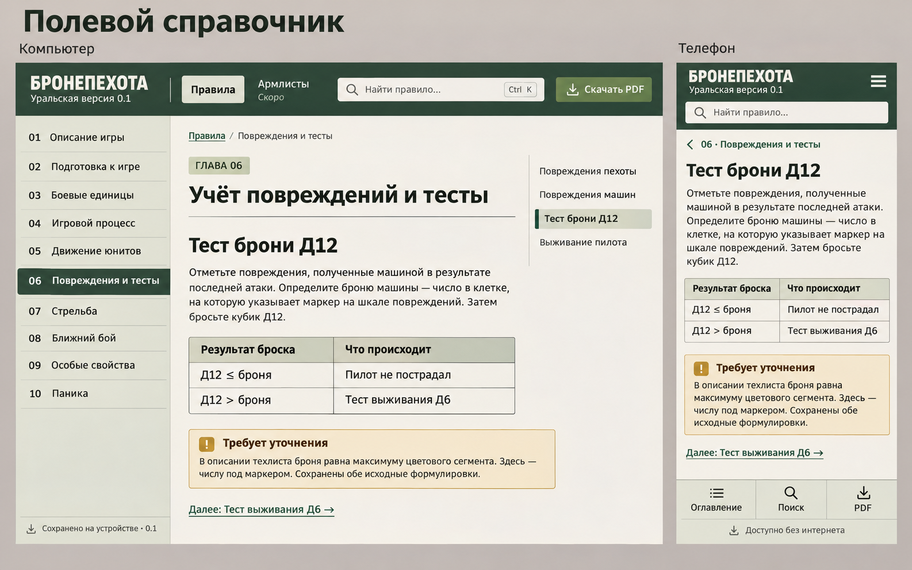

# Брендбук «Бронепехоты»

## Overview

**Creative North Star: "Полевой справочник"**

Основа стиля — спокойный военно-технический справочник: светлая бумажная область чтения, тёмно-зелёная шапка, приглушённая оливковая навигация, уверенная рубленая типографика. Характер создают цвета, порядок и точная иерархия. Игровые правила остаются главным содержимым.

Система предназначена для поиска во время партии и длительного чтения. Функциональные элементы различимы, игровые обозначения хорошо читаются, таблицы можно быстро просмотреть. Оформление PDF продолжает ту же визуальную систему с учётом печати.

**Статус:** брендбук актуализирован 2026-11-12 по локальной реализации каталога; редакция правил остаётся 0.3. Пользователь выбрал **первый вариант из первой тройки**, не «Северный атлас», и разрешил реализацию. Каталог «Полевой реестр» продолжает выбранный мир. Фактические значения извлечены из [общего CSS](assets/site.css), [CSS каталога](assets/catalog.css), [генератора страниц](scripts/build.py), [генератора каталога](scripts/catalog_site.py), [общего поведения](assets/app.js), [поведения каталога](assets/catalog.js) и [генератора PDF](scripts/make_pdf.py). YAML выше задаёт токены; расширения и примеры компонентов находятся в [.impeccable/design.json](.impeccable/design.json). Это дополнение к тому же брендбуку, не второй источник решений.

**Утверждённый визуальный эталон:**

Копия исходного exec-fcc761d4-0c51-4e65-9b0c-a3c1f211bb30.png сохранена без изменений. Название концепта, подписи устройств и серый презентационный фон в интерфейс не входят. Продуктовые границы — в [PRODUCT.md](PRODUCT.md), композиция и адаптации полного исходника — в [описании страницы правил](docs/design/rules-surface.md).

При первоначальной реализации проверены браузерные состояния правил при ширине 1440 и 390 CSS px, включая прямую ссылку Д12, оглавление, поиск, фокус и офлайн-обновление. Ручной review завершился ship для трёх исправлений: мобильного контекста главы, подсветки неточного поиска и фокуса на тёмных поверхностях. Это ограниченная проверка конкретных экранов, не универсальная сертификация доступности и не автоматический comp-diff. Первая версия 0.1 опубликована на GitHub Pages 2026-11-08. Сведения о CI и ограничениях проверки публичного адреса находятся в design-qa.md. Эти результаты не переносятся автоматически на новый каталог: его отдельная граница проверки записана в [описании каталога](docs/design/catalog-surface.md).

**Key Characteristics:**

- Светлая тёплая область чтения и тёмная лесная шапка.
- Оливковые второстепенные поверхности и заметная текущая позиция в правилах.
- Чёткая кириллица, компактные заголовки, удобная строка прозы.
- Плоские таблицы с тонкой сеткой и ясными игровыми обозначениями.
- Спокойные охристые редакционные примечания.
- Структурная адаптация навигации под телефон.

## Colors

Палитра связывает бумагу, лесной зелёный и серо-оливковые поверхности; охра отделяет редакционные пояснения от механики. Точные значения — в группе colors YAML.

### Primary

- **Лесной зелёный** (forest) — шапка, активная глава, ссылки и маркер текущего подраздела. **Глубокий лесной** (forest-dark) — наведение ссылок и подложка контрастного фокуса.
- **Приглушённая олива** (olive, olive-hover) — основное действие, прежде всего скачивание PDF; более тёмный оттенок показывает наведение.

### Secondary

- **Тёплая охра** (note, note-line, note-ink) — светлая заливка, граница и текст примечания «Требует уточнения».
- **Охристый фокус** (focus) — клавиатурный контур на светлом фоне. На лесной шапке и баннере обновления контур становится бумажным.
- **Подсветка найденного** (highlight) — фон совпадения в результатах и открытом тексте; само совпадение остаётся читаемым тёмным текстом.
- **Зоны прочности** (durability-green, durability-yellow, durability-red) — приглушённые заливки сегментов шкалы техники из исходного листа. Цвет дополняется числами, скоростью и бронёй; эти оттенки не становятся цветами навигации или общих статусов.

### Neutral

- **Тёплая бумага** (paper) — страница и поиск в шапке; **светлая олива** (sidebar) — оглавление и нижняя мобильная панель.
- **Угольный текст** (ink) — содержание; **серо-оливковый текст** (muted) — подписи и служебный контекст.
- **Оливковая линия** (line) — разделители; **оливковая шапка таблицы** (table) — также отметка главы и активный пункт локального оглавления.
- **Светлая строка** (table-body) и **тонированная строка** (table-alternate) — чередование таблицы; **белый** (white) — текст основных кнопок и активной главы.
- **Поле каталога** (catalog-field) — светлый фон отдельной строки поиска подразделений; окружающая страница сохраняет paper.

**The Meaningful Color Rule.** Зелёный обозначает навигацию и действие, охра — редакционное уточнение. Активное состояние дополнительно обозначается начертанием, маркером или подписью.

Палитра светлая и фиксированная: отдельная тёмная тема не реализована. Растровая неоднородность эталона не переносится в CSS как текстура или градиент.

## Typography

**Display Font:** PT Sans Narrow Bold с резервным sans-serif — словесный знак, а в каталоге также имена подразделений, заголовки секций и колонок бойцов. **Body Font:** PT Sans Regular / Bold с резервным sans-serif; локальные TTF с font-display: swap, без сетевого сервиса шрифтов и искусственного синтеза начертаний. PDF дополнительно встраивает PT Sans Italic.

### Hierarchy

- **Display** — плотный прописной знак; исходный токен display, при ширине до 1200 px размер 30 px, до 900 px — 28 px. Подпись редакции: 14 px, на телефоне 13 px.
- **Headline** — название главы; токен headline, до 900 px — 32 px, до 480 px — 29 px. Главная имеет собственный заголовок 44 / 36 / 33 px.
- **Title / Subtitle** — уровни h2 и h3 без изменения исходной иерархии; на мобильной компоновке 28 и 23 px. «Тест брони Д12» остаётся h3.
- **Body** — токен body; до 480 px применяется body-mobile. Полоса прозы ограничена 72ch, текст не сжимается ради высоты макета.
- **Label** — компактная отметка «ГЛАВА 06»; до 480 px размер 12 px. Это подтверждённая часть выбранного эталона, не общий приём для любых надписей.
- **Table / Caption** — самостоятельные меньшие размеры; таблица до 480 px — 14 px, подпись рисунка — 13 px. У номеров глав и таблиц включены табличные цифры.
- **Каталог** — заголовок страницы использует catalog-headline; до 900 px — 34 px, до 480 px — 30 px, название подробной карточки — 29 px. Имена в списке используют catalog-unit-name: до 1250 px — 23 px, до 480 px — 21 px. Заголовок секции catalog-section уменьшается до 24 / 22 px; названия оружия — 24 px / 1.25. Стоимость выделяется жирным начертанием и табличными цифрами, без отдельного акцентного цвета.
- **Колонки бойцов** — заголовок fighter-heading до 900 px уменьшается до 20 px. Значения fighter-value до 900 px — 18 px, на экране до 480 px — fighter-value-phone; метки строк PT Sans Narrow Bold 20 / 17 / 15 px. Мобильный размер относится к коротким игровым значениям, не к прозе правил.

**The Source Hierarchy Rule.** Заголовки, формулы и игровые обозначения сохраняют смысл и уровни исходника; типографическая унификация не меняет механику.

## Layout

Плоские области отделены отступами, тонкими линиями и заливками. Базовая оболочка: закреплённая шапка (96 px), левая колонка (258 px), основная область шириной до 1400 px с полями 28 / 36 / 48 px. Внутри страницы правил — текст и правое оглавление (192 px) с промежутком 32 px. Сам текст ограничен 72ch. Подробная композиция находится в docs/design/rules-surface.md.

| Условие CSS | Реальное изменение |
| --- | --- |
| min-width: 1700px | Левая колонка 280 px; текст до 760 px и оглавление 220 px с промежутком 44 px; поля основной области 36 / 56 px. |
| max-width: 1200px | Левая колонка 230 px; правое оглавление скрыто, доступен раскрываемый блок «В этой главе»; поля 26 / 30 px; подсказка Ctrl K скрыта. |
| max-width: 900px | Шапка с минимумом 122 px и поиском во второй строке; боковая и глобальная навигация заменены диалогом глав и нижней панелью; одна колонка; поля 22 px, снизу 136 px. |
| max-width: 480px | Поля 20 / 16 px, снизу 128 px; компактные таблицы и примечания; форма поиска переносится по содержимому. |

Ритм задают повторяемые шаги spacing. Абзацы отделены 18 px (16 px на узком телефоне), секции — 46 px (34 px до 480 px). Таблицы и рисунки получают собственные отступы; карточная сетка не используется для длинных правил. На телефоне нижняя панель учитывает safe-area-inset-bottom; якорная прокрутка оставляет место под шапку и нижнюю панель.

### Каталог: сетка и плотность

Каталог и подробная карточка обходятся без постоянной боковой панели. Основная область ограничена 1440 px, поля — 32 px сверху и 48 px по бокам и снизу. Список остаётся плоским реестром: одна кликабельная строка связывает превью группы, имя/вариант, фракцию, тип, стоимость и стрелку. Крупные полные фигуры и значения подробной карточки образуют единую таблицу: один боец — один столбец. Изображения сохраняют пропорции через object-fit:contain и выравниваются по нижнему краю; текст не накладывается на вырезки.

| Условие CSS каталога | Реальное изменение |
| --- | --- |
| По умолчанию | Список: сетка 230 px / гибкое имя / 150 / 170 / 108 / 24 px, промежуток 20 px, внутреннее поле 16 px, минимальная высота 128 px; превью 106 px. Таблица: метки 160 px, минимальная колонка бойца 180 px, область изображения 280 px. |
| max-width:1250px | Боковые поля 28 px; список 175 px / гибкое имя / 120 / 130 / 80 / 20 px с промежутком 14 px. Таблица: метки 140 px, колонка 150 px, изображение 260 px. |
| max-width:900px | Шапка 78 px, поля основной области 22 px. Фракция и тип переходят под имя; строка 155 px / гибкое имя / 70 px. Фильтры раскрываются в две колонки. Таблица: метки 100 px, колонка 132 px, изображение 215 px. Нижняя панель: «Правила», «Каталог», «Форум». |
| screen and max-width:480px | Верхнее поле 12 px, боковые 16 px; строка 110 px / гибкое имя / 57 px, промежуток 10 px, превью 90 px. Таблица: метки 90 px, колонка 132 px, изображение 205 px; значения 16 px / 1.25 с полями 4 / 6 px, однострочная строка около 29 px. |

Минимальная ширина таблицы складывается из столбца меток и числа бойцов, умноженного на ширину их колонки. При переполнении прокручивается контейнер таблицы, а метки остаются слева. Подсказка «Листайте» со стрелкой занимает ранее пустую первую ячейку шапки и сохраняется, пока таблица шире контейнера. На узком экране уменьшены отступы перед таблицей: после верхних ссылок 8 px, после заголовка карточки 12 px и после названия секции 8 px. Причина — показать фигуры и больше значений в первом экране без изменения ориентации таблицы. Точная композиция и граница проверки — [docs/design/catalog-surface.md](docs/design/catalog-surface.md).

### PDF и печать

Скачиваемый выпуск — 53 страницы A4 (210 × 297 мм), собранные ReportLab из тех же данных, что сайт: 10 глав, 54 поисковых пункта и 53 исходные иллюстрации. Основные поля: 20 мм слева, справа и снизу, 21 мм сверху. Бумага PDF белая, лесные заголовки и оливково-охристые смысловые акценты сохраняют узнаваемость без сплошной заливки листа.

Обложка использует PT Sans Narrow Bold (46/50 pt), подзаголовок PT Sans (26/32 pt). Основной текст — pdf-body; главы — 25/30 pt, подразделы — 16/20 и 12.5/17 pt. Ячейки и подписи — 8.5/11 pt, примечания — 9/12 pt. После обложки идут кликабельное оглавление и PDF-закладки; каждая глава начинается с новой страницы. Верхний колонтитул содержит знак и редакцию, нижний — дату выпуска и номер страницы.

Таблицы повторяют шапку при переносе, используют тонкую сетку (0.4 pt) и отступы ячеек 7 / 6 pt. Примечание имеет охристую рамку (0.6 pt), поля 12 / 10 pt и тот же заголовок, что на сайте. Иллюстрации сохраняют пропорции, ограничены шириной полосы и высотой 110 мм, удерживаются вместе с подписью. Браузерная печать — отдельное упрощённое представление текущей страницы: навигация скрыта, фон белый, текст 11 pt; она не подменяет собранный PDF.

## Elevation & Depth

Основные поверхности плоские: шапка, оглавления, таблицы и примечания не имеют теней. Иерархию создают тон и линии. Исключения функциональны: баннер обновления приподнят над контентом тенью (0 8px 24px #13261830), диалог отделён затемнением фона (#14261ddd); фокус на тёмной поверхности получает дополнительную обводку (0 0 0 2px var(--forest-dark)).

**The Reading First Rule.** Декоративный эффект не должен мешать чтению или откладывать показ правила. Анимация ограничена изменением фона кнопки или строки каталога и плавной прокруткой; уменьшенное движение отключает переходы и плавную прокрутку.

Переход фона кнопки длится 180 мс с cubic-bezier(.2,.8,.2,1); строка каталога использует ту же кривую и 150 мс. У диалога нет вступительной анимации. Задержки поиска правил (140 мс) и каталога (120 мс) служат обработке ввода, не визуальному эффекту. Появление фигур и раскрытие фильтров не анимируются; общая настройка уменьшения движения распространяется на каталог.

## Shapes

Основная геометрия прямоугольная, с небольшим скруглением control: кнопки, поля, активная глава, примечания, диалог и баннер. Более компактное скругление compact применяется к отметке главы и локальному оглавлению; highlight — к найденным словам. Таблицы имеют цельную прямую сетку, без отдельных карточек строк.

Пиктограммы — локальные SVG Phosphor 2.1.1, окрашиваемые через currentColor. Обычный размер 22 px; мобильные действия — 24 px, меню — 28 px; служебный статус — 18 px на компьютере и 15 px в нижней панели. Пиктограммы рядом с текстом скрыты от скринридера; кнопки только с иконкой имеют доступную подпись. Формы пиктограмм не заменяются случайными текстовыми символами.

## Components

### Buttons

Спокойные прямоугольные действия. Основная кнопка использует оливковую заливку, белый текст и токены button-primary; вторичная — прозрачную поверхность, лесной текст и тонкую границу line, при наведении светло-оливковую заливку. Минимальная высота — 44 px. Отключённая кнопка получает непрозрачность 0.65 и курсор ожидания; отдельной анимации нажатия нет.

Фокус видим: контур 3 px с отступом 4 px, охристый на светлом фоне, бумажный на шапке и баннере обновления с тёмной подложкой. Ссылка пропуска к содержанию появляется при фокусе. Табличная область имеет меньший отступ контура 2 px.

### Inputs / Fields

Поиск в шапке — светлое поле с иконкой слева и подсказкой Ctrl K справа на широком экране; на мобильном высота 42 px. Сочетание Ctrl/Cmd K переводит фокус в это поле. Основная форма поиска — светлое поле и отдельная кнопка «Найти»; доступные подписи сохраняются при пустом значении. Поле ввода наследует общий видимый фокус, каретка лесного цвета.

Поиск имеет состояния: приглашение с примерами, «Ищем…», количество найденных разделов, близкие совпадения, пустой результат и ошибка с кнопкой «Повторить». Результат содержит номер/название главы, заголовок-ссылку и фрагмент. Одна и та же проверка совпадений выбирает фрагмент и подсветку; переход сохраняет подсветку в главе. Статус объявляется через role=status, область результатов во время загрузки — через aria-busy.

### Navigation

Активная глава — лесная строка со светлым жирным текстом и aria-current=page; наведение остальных строк слегка усиливает оливковую заливку. Правое оглавление использует активную оливковую подложку, лесной маркер 3 px и aria-current=location; при прокрутке активная позиция обновляется. Заголовок пункта сам служит прямой ссылкой.

На мобильном экране меню и действие «Оглавление» открывают нативный модальный диалог (до 400 px шириной, максимум 92vw и 88dvh). Фокус начинается на закрытии, после закрытия возвращается к открывшей кнопке. Закрытие доступно кнопкой, Escape и нажатием вне окна. Список глав внутри прокручивается отдельно.

При прямом переходе к пункту на ширине до 900 px над его заголовком появляется ссылка со стрелкой и номером/названием главы. Она возвращает к началу главы и занимает обычное место в потоке, не перекрывая правило. Нижняя панель содержит подписанные действия «Оглавление», «Поиск», «Форум», «PDF» и строку офлайн-состояния.

### Tables, illustrations and editorial notes

Таблица — семантические caption, шапка и строки с выравниванием по левому верхнему краю. Широкая таблица прокручивается внутри доступной с клавиатуры области, не расширяя страницу. Шапка оливковая, строки чередуются, размеры текста сохраняются согласно мобильному токену.

Исходные иллюстрации показываются пропорционально (не выше 620 px в статье), имеют подпись и открываются крупно по ссылке. Если изображённая таблица дополнена текстовой расшифровкой, исходная картинка остаётся в раскрываемом блоке «Оригинальная иллюстрация из правил».

Примечание — единый светлый охристый блок с тонкой рамкой, значком предупреждения и обязательным заголовком «Требует уточнения». В нём нет механики, выдаваемой за подтверждённую поправку. На узком телефоне внутренние поля уменьшаются до 14 / 15 px; текст остаётся 15 px, заголовок — 17 px.

### Offline status and update

Постоянный текстовый статус размещён под главами на компьютере и под быстрыми действиями на телефоне. Он различает сохранение, готовую редакцию, неудачное сохранение с повтором и отсутствие поддержки офлайн-режима с предложением PDF. «Доступно без интернета» появляется после подтверждения полной сохранённой сборки; рядом указан её номер. При повторном открытии статус запрашивается у уже активного Service Worker до сетевой регистрации, поэтому сохранённая редакция видна и без сети.

Новая редакция предлагается в лесном баннере с действиями «Обновить» и «Позже». Пока обновление не принято, сохраняется прежняя редакция. После принятия кнопка временно отключена; активная сборка переключается и страница перезагружается. Баннер на телефоне поднят над нижней панелью. Статус и баннер несут текст, а не только цвет.

### Каталог: «Полевой реестр»

Утверждён 2026-11-12 второй вариант с уточнением: крупные бойцы горизонтально, параметры каждого вертикально под ним. [Уточнённый макет](docs/design/catalog-options/2026-11-12/02-field-register-large-columns-r1.png) задаёт композицию; данные и изображения поступают из исходных листов и принятых вырезок. Это расширение «Полевого справочника» с теми же лесной шапкой, бумажным фоном, линиями, скруглениями и локальными SVG Phosphor.

**Поиск и список.** Поле высотой 52 px и отдельная кнопка «Найти» стоят над фильтрами. Select и поля стоимости имеют высоту от 44 px, границу line и скругление control; подписи 14 px, значения 16 px. Фракция, тип и стоимость видны сразу на компьютере; ранг и «Только тестовые» находятся в «Ещё фильтры». На телефоне основной блок изначально свёрнут, если URL не содержит фильтров; активные фильтры из ссылки раскрываются. Состояния: загрузка поиска с отключёнными полями, число результатов, пустой список со сбросом, ошибка с повторной загрузкой при сохранении всех статических карточек. Число результатов объявляется через role=status. Наведение строки даёт sidebar; клавиатурный контур остаётся охристым и смещён внутрь строки на 3 px.

**Вариант и тест.** Текстовые метки 12 px / 1.3 со скруглением compact и полями 3 / 7 px: вариант использует sidebar/forest, «Тест» — note/note-ink. До 480 px — 11 px и поля 2 / 5 px. Метки передают статус словами и не являются декоративными надзаголовками.

**Таблица профилей.** Скруглённый контейнер с границей line и нативной горизонтальной прокруткой получает tabindex=0, role=region и доступное имя. Семантические заголовки колонок и строк связаны с каждой ячейкой через headers. Имя/номер бойца находится на заливке table, полное изображение — на paper. Нечётные строки используют sidebar, остальные сохраняют светлое чередование общей таблицы; закреплённые метки имеют непрозрачную подложку. Значения центрированы, метки слева. Свойства и заголовки параметров ведут к словарю; наведение подчёркивает ссылки, фокус наследуется. Макет не усредняет индивидуальные профили.

**Техника, кавалерия и герои.** Изображение и сводка расположены в сетке 2:1 с промежутком 40 px; высота изображения 350 px. До 900 px — две равные колонки, промежуток 24 px и изображение 280 px; до 480 px — один столбец и изображение 260 px, сводка в двух колонках. Оружие оформляется плоскими секциями с верхней линией: две колонки с промежутками 24 / 40 px, на узком телефоне одна. Область изображений оружия — 150 / 125 / 145 px. Шкалы состоят из ячеек не уже 32 px, высотой 32 px, с промежутком 4 px и границей line; сегменты прочности имеют спокойные исходные цветовые зоны, подписи скорости и при наличии брони. Примечания «Требует уточнения» наследуют существующий компонент.

**Контекст и действия.** Верхние ссылки «К каталогу» и «Ссылка» сохраняют лёгкое текстовое оформление; подтверждение копирования меняет подпись на «Скопировано» и объявляется через role=status. Если буфер обмена недоступен, появляется подписанное поле с выделенной ссылкой. «Обозначения и свойства» — нативный details с тонкими верхней и нижней границами, заголовком PT Sans Narrow Bold 24 px (22 px до 480 px), абзацами до 75ch и подсветкой текущего термина sidebar. Ссылки параметров раскрывают его; определения ведут к правилам. «Другие варианты» — список ссылок с разделителями.

**Навигация и офлайн.** Общая навигация теперь содержит «Правила», «Каталог», «Форум». На страницах каталога верхняя строка показывает статус сохранения вместо поиска правил и кнопки PDF, нижняя мобильная панель имеет три равные колонки; текущий каталог отмечен olive/white и aria-current. Ссылка на PDF правил сохраняется в общем подвале; отдельный PDF каталога не создаётся. Базовая офлайн-копия включает все карточки и малые изображения, ×4 подставляется по мере просмотра при ширине от 901 px и возвращается к малой версии при ошибке. Правила и PDF остаются в редакции 0.3.

Изменение затрагивает список, подробные карточки, общую навигацию и статус сохранения. Оно связывает узнаваемую фигурку с её собственными параметрами и делает продолжение мобильной таблицы заметным. Каталог реализован; повторный независимый просмотр закрыл все четыре замечания к исправлениям плотности, подсказки и документации. Вердикт ship относится к этому проверенному набору исправлений. Результат публикации фиксируется отдельно в PRODUCT.md и отчёте проверки каталога. Растровый макет и отдельные снимки не подтверждают универсальную адаптивность или доступность.

## Do's and Don'ts

### Do

- **Do** сохранять светлую область чтения, лесную шапку и приглушённые оливковые поверхности выбранного «Полевого справочника».
- **Do** применять локальную PT Sans для прозы и значений, PT Sans Narrow Bold для словесного знака и компактных заголовков каталога.
- **Do** сохранять полный текст действующей редакции, читаемые таблицы, пропорции иллюстраций и контекст главы при прямом переходе с телефона.
- **Do** отделять редакционные примечания заголовком «Требует уточнения» и охристым оформлением одинаково на сайте и в PDF.
- **Do** проверять состояния клавиатуры, поиска и офлайн-редакции на фактических компонентах.
- **Do** фиксировать визуальные изменения в этом брендбуке и sidecar в том же наборе изменений; композицию экрана также обновлять в docs/design.

### Don't

- **Don't** подменять выбранное направление «Северным атласом» или другим вариантом без нового решения пользователя.
- **Don't** переносить в интерфейс презентационный фон, подписи устройств, название концепта или растровые погрешности эталона.
- **Don't** уменьшать текст или убирать исходные абзацы ради совпадения с высотой демонстрационного макета.
- **Don't** превращать справочную страницу в декоративную игровую панель или выдавать содержание макета за источник правил.
- **Don't** распространять тени баннера на плоские навигационные и читательские поверхности.
- **Don't** называть проверку двух размеров экрана всеобщей проверкой доступности или считать локальную сборку опубликованным сайтом.

**Изменения от 2026-11-08:** документ направления обновлён после реализации: закреплены реальные токены, локальные шрифты/иконки, брейкпоинты, состояния поиска и офлайн-режима, диалог и PDF. Мобильная ссылка на главу восстановлена ради ориентации в прямом переходе; фокус на тёмных поверхностях получил светлый контур ради различимости. Затронуты страницы правил, поиск, общая навигация и PDF; выбранный визуальный мир сохранён.

**Дополнение для редакции 0.2 от 2026-11-08:** история выпусков на странице «Редакция и изменения» идёт от нового к старому. Каждый выпуск использует существующие h2, абзац даты и маркированный список; новые цвета, карточки и типографические стили не вводятся. На обложке PDF уточнён статус согласованных изменений механики; геометрия обложки и типографика сохранены. Затронуты история редакций и текст обложки; страницы правил меняются только по содержанию.

**Форум от 2026-11-09:** в основной навигации после «Армлисты» добавлена ссылка «Форум» с подписью GitHub тем же small 13 px. Высота ссылок не меньше 44 px; наведение подчёркивает текст, фокус наследует бумажный контур шапки. На телефоне панель содержит четыре равные колонки minmax(0, 1fr), высота действий от 66 px; до 480 px горизонтальный padding уменьшен до 2 px, чтобы «Оглавление» помещалось при ширине 320 px. Форум использует локальную Phosphor chat-circle 2.1.1, 24 px; наведение действий — table. Палитра, шрифты, safe area и отступ под панель сохранены.

Форум открывается в новой вкладке через обычную ссылку с noopener noreferrer. Доступное имя и title сообщают GitHub, необходимость сети и новую вкладку. На странице «Редакция и изменения» раздел «Обсуждение правил» объясняет вход, интернет и порядок принятия изменений; используются существующие h2 и абзацы. Статус «Доступно без интернета» относится к справочнику. Обсуждения работают во внешнем интерфейсе GitHub; его оформление не управляется CSS сайта. Причина: дать постоянный доступ к обсуждениям, сохранив место в правилах и выбранный стиль. Затронуты общая навигация всех страниц и описание редакции. Правила и PDF остаются в редакции 0.2.

**Уточнение форума от 2026-11-09:** категория вопросов во внешнем интерфейсе GitHub называется Q&A — название согласовано пользователем для работы формы. Описание и поля русские: «Версия правил», «Ссылка на пункт правил», «Игровая ситуация и вопрос». Все три поля обязательны, используются штатные поля GitHub и обозначение обязательности звёздочкой. В навигации сайта остаётся «Форум»; собственные стили и токены не меняются.

**Редакция 0.3 от 2026-11-11: тестовый статус указывается словами «(тестовое правило)» в существующем заголовке h2. Он сохраняется в оглавлении, поиске и закладках PDF. Укрытия пехотинцев и машин представлены отдельными разделами с существующими таблицами; строка «Все 6 — Стрелять нельзя» делает крайний случай явным. На обложке PDF объяснена отметка тестовых правил. Причина: различать экспериментальную механику и типы целей без введения новых цветов или компонентов. Затронуты глава «Стрельба», оглавления, поиск и PDF; сетка, токены и типографика сохранены.**

**Ручное обновление от 2026-11-11:** Ручное обновление: надпись «Доступно без интернета · версия» стала текстовой кнопкой с подчёркиванием и title «Проверить и загрузить обновления с сайта». Нативный button поддерживает Tab, Enter и пробел; минимальная высота 44 px. Существующие лесной цвет, 18/15 px значок и охристый focus-visible сохранены. Под действием находится отдельный role=status, 12 px/1.4, muted: проверка и загрузка, актуальная версия, переключение либо ошибка с сохранением прежней копии. Во время проверки действие отключено и aria-busy=true. На телефоне нижнее поле текста, отступ якорей и положение баннера зависят от измеренной высоты панели, включая переносы обратной связи и safe area. Нажатие проверяет и устанавливает новую сборку целиком; автоматическое предложение по-прежнему требует «Обновить». Причина: дать ручной запуск обновления, сохранив атомарную офлайн-копию. Поверхности: боковая панель компьютера и нижняя панель телефона; правила и PDF остаются 0.3.
