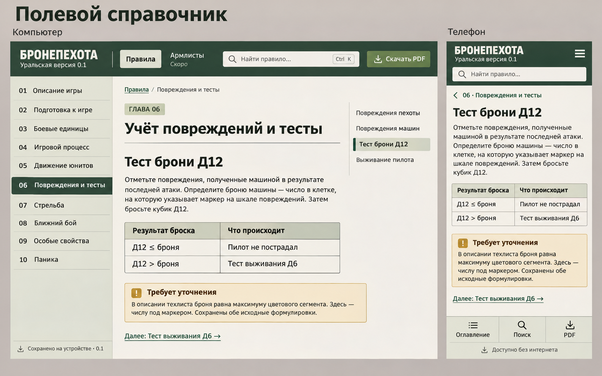

# Страница правил — «Полевой справочник»

Статус: реализовано и сверено с выбранным направлением 2026-11-08. Выбор пользователя — **первый вариант из первой тройки**. Реализация разрешена прямым поручением «приступай к реализации по тз». Публикация GitHub Pages пока ожидает входа в GitHub.

Режим поверхности: **Read**, с поиском и навигацией во время партии. Единственный брендбук — [DESIGN.md](../../DESIGN.md), фактические компоненты — assets/site.css, assets/app.js, scripts/build.py.

## Визуальный источник

Сохранена точная копия exec-fcc761d4-0c51-4e65-9b0c-a3c1f211bb30.png. Слева показана компьютерная версия, справа — телефон. Демонстрационный фрагмент «Тест брони Д12» не является полным объёмом или источником правил. Текст, таблицы и иллюстрации перенесены из предоставленного DOCX: десять глав, 54 поисковых пункта, 53 исходные иллюстрации.

## Компьютер

1. Закреплённая лесная шапка высотой 96 px: словесный знак PT Sans Narrow Bold, редакция, «Правила» / «Армлисты», поле поиска и оливковая кнопка «Скачать PDF».
2. Светло-оливковая колонка глав шириной 258 px, закреплённая под шапкой. Десять пронумерованных пунктов отделены линиями; активная глава имеет лесную заливку, светлый жирный текст и aria-current=page. Внизу — статус сохранённой редакции и история изменений.
3. Основная область до 1400 px: хлебные крошки, «ГЛАВА 06», h1 главы и полный текст. Поля 28 px сверху, 36 px по бокам, 48 px снизу. Статья ограничена 72ch.
4. Локальное оглавление справа шириной 192 px, промежуток с текстом 32 px. Текущий подраздел отмечен оливковой подложкой, лесным маркером 3 px и aria-current=location.
5. Таблицы имеют подпись, единую сетку и оливковую шапку. Примечание «Требует уточнения» использует охристую поверхность и следует за соответствующим правилом. Далее продолжается полный текст; внизу главы — переходы к соседним главам.

При ширине от 1700 px колонка глав становится 280 px, полоса текста ограничена 760 px, правое оглавление — 220 px, промежуток — 44 px. До 1200 px правая колонка скрывается, локальное оглавление доступно как раскрываемое «В этой главе», левая колонка уменьшается до 230 px.

## Телефон

Мобильная компоновка включается до 900 px; проверенный узкий экран — 390 × 844 CSS px.

1. Закреплённая шапка с минимальной высотой 122 px: знак и редакция, кнопка оглавления, поиск второй строкой на всю доступную ширину. Глобальные ссылки и верхняя кнопка PDF скрыты.
2. Одна колонка текста; поля 22 px, до 480 px — 16 px по бокам. Основной текст до 480 px — 17/25.5 px. Полный заголовок главы находится в начале страницы.
3. При прямой ссылке на подраздел над его заголовком видна ссылка со стрелкой «06 · Учёт повреждений и тесты». Она возвращает к началу главы. Контекст занимает место в потоке и не накрывает заголовок Д12.
4. Подраздел Д12 остаётся h3 согласно исходной структуре. Таблица имеет шрифт 14 px до 480 px и может прокручиваться по горизонтали внутри собственной области; страница сохраняет свою ширину.
5. Редакционное примечание остаётся рядом с правилом; исходные изображения сохраняют пропорции и доступны крупно по ссылке. Расшифрованные изображения таблиц сохраняются в раскрываемом блоке.
6. Закреплённая нижняя панель: три подписанных действия «Оглавление», «Поиск», «PDF», затем текстовый офлайн-статус. Панель учитывает безопасный нижний отступ устройства; контент имеет дополнительное нижнее поле 136 px, до 480 px — 128 px.

## Реализованные состояния

- **Оглавление:** нативный модальный диалог со списком десяти глав, закрытием кнопкой / Escape / нажатием на фон; начальный фокус на закрытии, возврат фокуса в открывшее действие.
- **Поиск:** приглашение и примеры, загрузка, результаты с путём и подсветкой, близкие совпадения, пустой результат, ошибка с повтором. Переход открывает точный пункт и сохраняет подсветку в тексте.
- **Навигация:** текущая глава и текущий пункт выделены не только цветом; заголовки содержат прямые ссылки; при мобильном deep link виден контекст главы.
- **Клавиатура:** ссылка пропуска к содержанию, доступный фокус, Ctrl/Cmd K для поиска, прокручиваемая таблица с фокусом. На светлом фоне контур охристый, на лесной шапке и баннере — бумажный с тёмной подложкой.
- **Офлайн:** сохранение, готовая редакция с номером, ошибка с повтором, запасной путь через PDF при отсутствии поддержки. При повторном открытии статус запрашивается у уже активного Service Worker до сетевой регистрации. Новая сборка предлагается баннером «Обновить» / «Позже»; переключение — после принятия.
- **Армлисты:** страница «Раздел готовится» с возвращением к правилам; данные армий не придуманы.
- **Уменьшенное движение:** плавная прокрутка и переход цвета кнопки отключаются.

## Обоснованные адаптации эталона

- Полные исходные абзацы, списки и изображения увеличивают высоту. Сокращение ради совпадения с демонстрационной картинкой не применяется.
- Обычное открытие главы начинается с её реального первого пункта. Прямая ссылка Д12 прокручивает к Д12, сохраняя доступ к главе.
- Таблица результата теста добавлена рядом с исходными пунктами без удаления исходного текста; примечание следует за таблицей.
- Иерархия h1/h2/h3 отражает источник. Отметка «ГЛАВА 06» и лесной маркер оглавления сохранены как части выбранного дизайна.
- PT Sans и Phosphor 2.1.1 поставляются локально. Растровая текстура эталона не воспроизводится.

## Проверка и фиксация

Ручной review использовал viewport и полностраничные снимки при ширинах 1440 и 390 CSS px. После исправлений проверены мобильный контекст главы, единое неточное совпадение для поиска/фрагмента/подсветки и контрастный фокус на тёмной поверхности. Вердикт ship относится к этим трём исправлениям; автоматические detect/comp-diff не выполнялись. Проверка двух размеров не означает доступность на всех устройствах.

PDF собран из того же содержания: 53 страницы A4 с оглавлением, закладками, номерами страниц и иллюстрациями; оформление описано в DESIGN.md. Полученный PDF сверён по SHA256. Само нативное событие скачивания без сети не подтверждено из-за тайм-аута инструмента; это ограничение проверки, а не основание заявлять полный pass. Браузерная печать текущей главы имеет собственное упрощённое представление.

Изменение от 2026-11-08: статус макета заменён описанием реализованного экрана; закреплены реальные размеры и состояния. Мобильный контекст главы восстановлен для навигации с прямых ссылок, светлый фокус добавлен для различимости на шапке. Затронуты общая навигация и страница правил; выбранная композиция сохранена.

